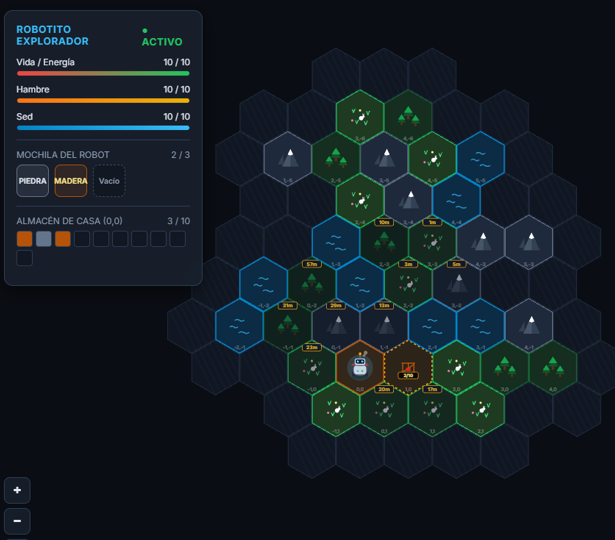

# 🌐 HexaWorld IA: Explorador y Colonizador Hexagonal Autónomo

> **Un entorno de simulación y benchmark empírico donde un Modelo de Lenguaje Grande (LLM) local controla de forma autónoma a un robot colonizador en un mundo procedural con niebla de guerra, reglas de supervivencia y gestión de memoria a largo plazo.**



---

## 📖 ¿Qué es HexaWorld IA?

HexaWorld IA es un simulador por turnos diseñado para evaluar cómo razonan, planifican y ejecutan acciones los modelos de lenguaje (LLM) locales (vía **LM Studio**, **Ollama** o cualquier servidor compatible con la API de OpenAI).

El modelo asume el papel de un pequeño robot habitante que despierta en las coordenadas `(0, 0)` de un valle hexagonal desconocido. Cada acción del robot consume **1 minuto de vida simulada**. El robot debe:
1. **Sobrevivir**: Cuidar sus niveles de agua y alimento (la deshidratación o inanición a 0 causan la muerte y el fin de la partida).
2. **Explorar**: Revelar casillas ocultas bajo la niebla de guerra mediante coordenadas axiales hexagonales `(q, r)` y 6 direcciones (`E`, `W`, `NE`, `NW`, `SE`, `SW`).
3. **Cosechar y Logística**: Extraer madera en bosques, comida en pastos y minerales (piedra, cobre, hierro, diamante) en montañas, respetando límites de inventario (3 objetos) y tiempos de agotamiento natural del terreno (60 min).
4. **Construir y Almacenar**: Transportar suministros a la Casa central, almacenar recursos valiosos y ejecutar `AMPLIAR_CASA` para expandir el hogar y aumentar la capacidad del almacén.
5. **Memoria Cuántica Persistente**: Para superar la pérdida de contexto periódica (cada 10 minutos), el robot dispone de una libreta personal (`memoria_robot.txt`) que puede actualizar y consultar libremente.

---

## 🕹️ Mecánicas del Mundo

```
                 (NW)  /\  (NE)
                      /  \
                (W)  | q,r |  (E)
                      \  /
                 (SW)  \/  (SE)
```

| Terreno | Recursos Disponibles | Función / Regla Especial |
| :--- | :--- | :--- |
| 🏠 **Casa** | Almacén Seguro (10 slots) | Permite `ALMACENAR`, `COGER` y `AMPLIAR_CASA`. Base de operaciones. |
| 🌲 **Bosque** | Madera | Tala de madera. Queda agotado durante 60 minutos tras cosechar. |
| 🌾 **Pasto** | Comida | Forrajeo de alimento. Queda agotado durante 60 minutos. |
| 🏔️ **Montaña** | Piedra (69%), Cobre (20%), Hierro (10%), Diamante (1%) | Cantería y minería. Fuente de piedra para ampliar la casa. |
| 💧 **Agua** | Agua dulce | Intransitable, pero permite ejecutar `BEBER` desde cualquier casilla adyacente para saciar la sed al 10/10. |
| 🚧 **En Obras** | Infraestructura | Parcelas edificadas adyacentes resultantes de las ampliaciones del robot. |

---

## 🚀 Instalación y Puesta en Marcha Rápida

### Requisitos Previos
1. **Python 3.10 o superior**.
2. **LM Studio** (u otro servidor compatible con OpenAI API como Ollama o LocalAI) corriendo en la misma máquina o en la red local.

---

### Paso 1: Configurar el Modelo en LM Studio
1. Abre **LM Studio** y carga un modelo de instrucciones (recomendado: **`Qwen2.5-7B-Instruct`**, **`Llama-3.1-8B-Instruct`** o **`Gemma-2-9B-Instruct`**).
2. Ve a la pestaña **Local Server** (icono de dos flechas/servidor `<->`).
3. Inicia el servidor en el puerto por defecto (`1234`).

---

### Paso 2: Ejecutar el Juego

#### En Windows:
Simplemente haz doble clic en:
```cmd
iniciar_juego.bat
```
*(El script verificará e instalará automáticamente las dependencias y abrirá el navegador).*

#### En Linux o macOS:
Abre una terminal en la carpeta del proyecto y ejecuta:
```bash
chmod +x iniciar_juego.sh
./iniciar_juego.sh
```

#### Modo Manual (Cualquier Sistema Operativo):
```bash
pip install -r requirements.txt
python -m uvicorn server:app --app-dir backend --host 127.0.0.1 --port 8000 --reload
```

Abre tu navegador en:
👉 **[http://127.0.0.1:8000](http://127.0.0.1:8000)**

---

## ⚙️ Conexión con LM Studio u otro Servidor LLM

Por defecto, el motor detecta automáticamente la presencia de LM Studio probando:
1. `http://localhost:1234`
2. `http://127.0.0.1:1234`
3. Red local (`http://192.168.x.x:1234`)

Si tu servidor de inferencia corre en otra IP o puerto, puedes definir la variable de entorno `LM_STUDIO_HOST`:

**Windows (PowerShell):**
```powershell
$env:LM_STUDIO_HOST="http://192.168.1.100:1234"
python -m uvicorn server:app --app-dir backend --host 127.0.0.1 --port 8000
```

**Linux / Mac:**
```bash
export LM_STUDIO_HOST="http://192.168.1.100:1234"
python3 -m uvicorn server:app --app-dir backend --host 127.0.0.1 --port 8000
```

---

## 📁 Estructura del Proyecto

```
app/
├── backend/
│   ├── ai_client.py         # Motor de inferencia y configuración de LM Studio
│   ├── game.py              # Motor de simulación del mundo hexagonal y reglas
│   └── server.py            # API FastAPI y streaming SSE en tiempo real
├── static/
│   ├── index.html           # Interfaz web responsiva con canvas interactivo
│   ├── game.js              # Renderizador hexagonal, HUD dinámico y controles
│   └── style.css            # Estilos oscuros modernos y componentes visuales
├── memoria_robot.txt        # Cuaderno de memoria persistente del robot (vacío)
├── system_prompt.txt        # Prompt del sistema editable con reglas y catálogo
├── VERSION.txt              # Control de versión semántica del proyecto
├── requirements.txt         # Dependencias Python mínimas (FastAPI, uvicorn, openpyxl)
├── iniciar_juego.bat        # Lanzador automático de 1 clic para Windows
├── iniciar_juego.sh         # Lanzador automático de 1 clic para Linux/macOS
├── .gitignore               # Ignora cachés, logs pesados y partidas temporales
├── screenshot.png           # Captura de pantalla de la interfaz de juego
└── README.md                # Esta documentación
```

---

## 🛠️ Personalización y Experimentación

- **Modificar Reglas o Terrenos**: Puedes editar `system_prompt.txt` para enseñarle al robot nuevas mecánicas o ajustar sus objetivos prioritarios.
- **Ajustar Parámetros del LLM**: En `backend/ai_client.py` puedes ajustar `temperature` (recomendado: 0.2 a 0.4 para rigor sintáctico) y `max_tokens` (700 para evitar cortes en modelos con cadenas de pensamiento).
- **Probar otros Modelos**: Simplemente cámbialo en la interfaz de LM Studio; el backend detecta el nuevo modelo en tiempo real y actualiza el badge superior en la web sin reiniciar el servidor.

---

## 📜 Licencia y Contribuciones

Proyecto de código abierto desarrollado para experimentación y benchmarking con agentes autónomos en entornos simulados. ¡Las sugerencias, mejoras en el motor y pruebas con nuevos modelos LLM son bienvenidas!
